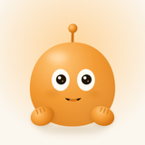
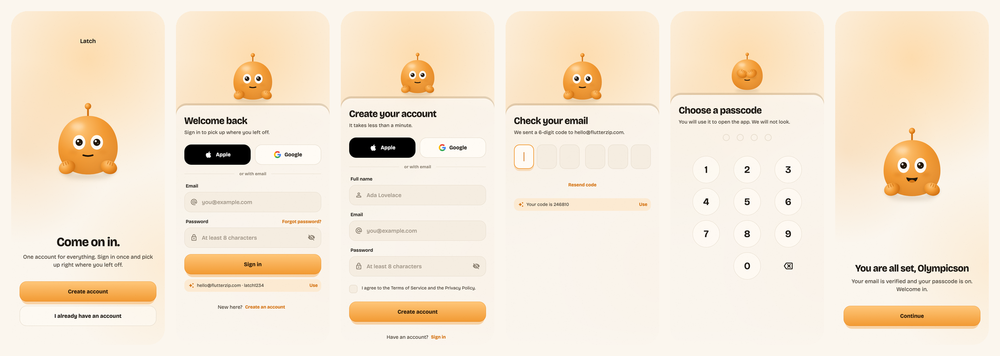
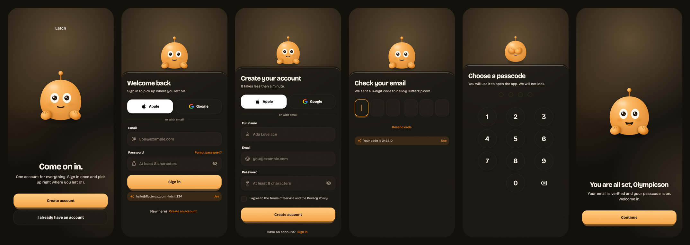
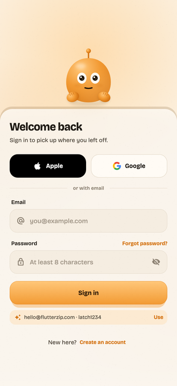
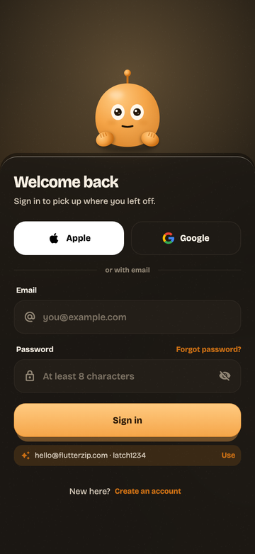
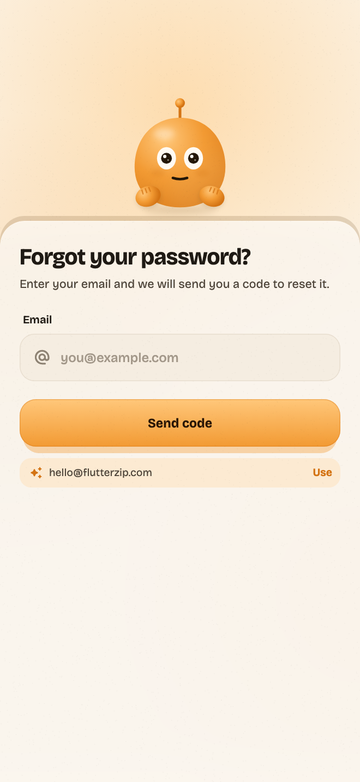
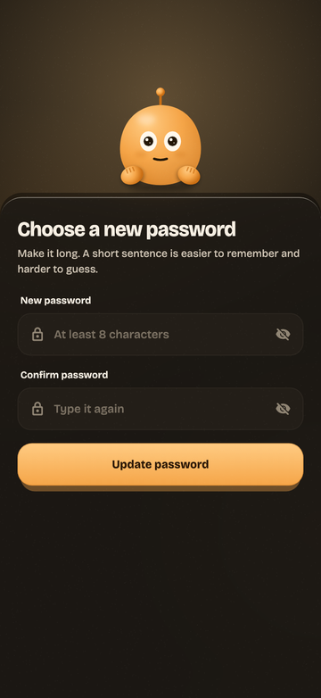
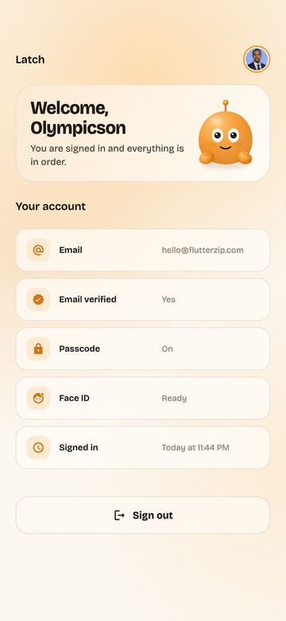
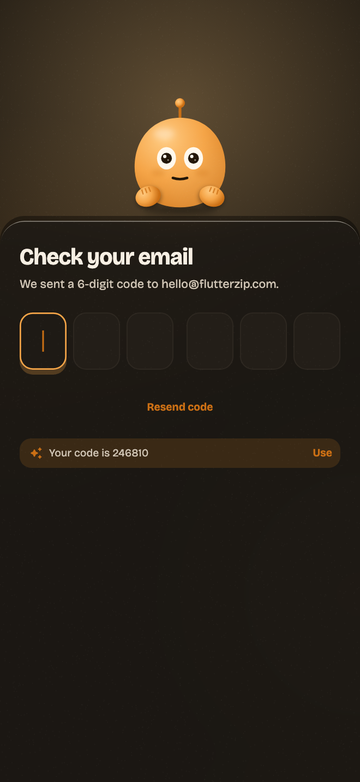

<p align="center">
  
</p>

<h1 align="center">Latch</h1>

<p align="center">
  A complete, fully animated Flutter sign-in and sign-up flow, with a little
  character that watches you type and covers its eyes for your password.
</p>

<p align="center">
  <a href="https://flutterzip.com"></a>
  <a href="https://instagram.com/flutter_zip"></a>
  
  
  
  
  
</p>

<p align="center">
  
</p>
<p align="center">
  
</p>

## Highlights

- **The keeper.** A character drawn entirely in code. Its eyes follow your
  caret along the email field, both paws cover its eyes on the password,
  one paw slides down to peek when you show the password, it shakes its
  head at a wrong password and hops with happy eyes when you are in. It
  breathes, blinks and looks around on its own, and flies between screens
  as a Hero.
- **Every screen of a real auth flow.** Welcome, sign in, sign up, forgot
  password, a 6-digit code, a new password, a 4-digit passcode, all set,
  and a signed-in Home with sign out.
- **Motion everywhere, all of it interruptible.** One ticker drives the
  keeper with frame-rate independent smoothing, so any reaction can cut
  into any other without a jump. Entrances come from one controller sliced
  into intervals. Everything respects Reduce Motion.
- **Fields that explain themselves.** Titles sit above the box and take
  the accent on focus, the box glows, errors name the problem and shake the
  field, and an old error disappears as soon as you edit.
- **A button that never looks broken.** While working, its label becomes
  a pair of the keeper's eyes glancing about; when done it shrinks to a
  circle and draws a tick.
- **A one-time code done right.** One hidden field behind six boxes, so
  paste and SMS autofill work. Digits drop in, a wrong code shakes the row
  red, the right one fills the boxes in a wave.
- **A custom passcode pad** with springy dots, and the keeper keeps its
  eyes covered the whole time.
- **Light and dark from one palette file**, a splash that builds the logo
  from nothing, Apple and Google buttons, a password meter that rewards
  length, and a floating Demo settings button.

## Screens

| Light | Dark |
|---|---|
|  |  |
|  |  |
|  |  |

## Try the demo

Any well-formed email and password signs you in as the demo person. Tap
**Use** under the form to fill it in.

| What | Value |
|---|---|
| Demo account | `hello@flutterzip.com` / `latch1234` |
| The wrong-password state | the password `wrongpass` |
| The one-time code | `246810` (any other code shows the wrong-code state) |
| A passcode mismatch | type two different passcodes |

The round button at the top right opens **Demo settings**: theme
(auto, light, dark), demo hints on or off, and reset demo data.

## Getting started

```bash
git clone https://github.com/flutterzip/latch.git
cd latch
flutter pub get
flutter run
```

Open a screen straight away (handy for screenshots):

```bash
flutter run --dart-define=startRoute=signIn
# welcome, signIn, signUp, forgot, verify, newPassword, passcode, allSet, home
```

`--dart-define=timingScale=0` skips every simulated wait, the splash
included.

## Make it yours

| To change | Edit |
|---|---|
| Every colour, light and dark | `lib/config/palette.dart` |
| The app's name and tagline | `lib/config/brand.dart` |
| Spacing, radii, type scale | `lib/config/theme.dart` |
| How things move (durations, curves, how fast the keeper follows) | `lib/config/motion.dart` |
| How long things wait (simulated network, splash) | `lib/config/timing.dart` |
| The demo account, wrong password and code | `assets/data/demo.json` |
| Plug in a real backend | implement `AuthRepository` in `lib/data/auth_repository.dart` (a commented `RemoteAuthRepository` shows the shape) |
| Real Apple and Google sign-in | `signInWith` in the same file, with `sign_in_with_apple` and `google_sign_in` |
| The character | `lib/widgets/keeper/` |

## Project structure

```
lib/
  config/       palette, theme, motion, timing, brand
  data/         Account, AuthRepository, the demo repository
  state/        session and demo settings (Riverpod)
  widgets/      everything the screens are built from
    keeper/     the character: controller, painter, widget
    widgets.dart  one import for a screen
  screens/      one folder per screen, each a short file
  demo/         Demo settings button and launch hooks
```

## How it is built

Each screen is a short file that puts the widgets in `lib/widgets/`
together. A screen owns a `KeeperController` and wires it to its fields:

```dart
final keeper = KeeperController();

LatchField.email(controller: email, onCaret: keeper.follow),
LatchField.password(controller: password, onFocus: keeper.cover, onReveal: keeper.peek),
LatchButton(label: 'Sign in', busy: busy, done: done, onPressed: signIn),
```

and calls `keeper.shake()`, `keeper.cheer()`, `keeper.bump()` or
`keeper.wave()` when something happens. The keeper is a `CustomPainter`
on a 200 by 200 design canvas; every moving part is a field of
`KeeperPose`, chased each frame toward the controller's targets.

The backdrop lives under the navigator and routes are see-through, so the
lamplit room never cuts between screens while the keeper flies from one
header to the next.

## Testing

```bash
flutter analyze --fatal-infos
flutter test
```

37 tests cover every screen and the full flows: validation, the wrong
password, the wrong code, a passcode mismatch, sign up through verify and
passcode to Home, the reset path, sign out, the splash handing over
without rebuilding the first screen, and that no on-screen string has an
em dash.

`flutter test tool/render/screens_test.dart` renders every screen in light
and dark with the real fonts to `build/screens/`.

## Made by FlutterZip

A new Flutter UI every day. Follow [@flutter_zip](https://instagram.com/flutter_zip)
and find more at [flutterzip.com](https://flutterzip.com).

## Credits

- [Bricolage Grotesque](https://github.com/ateliertriay/bricolage) by
  Mathieu Triay, SIL Open Font License 1.1 (`assets/fonts/OFL.txt`).
- The keeper, the logo and the icon are drawn in code for this project.

## License

MIT. See [LICENSE](LICENSE).
